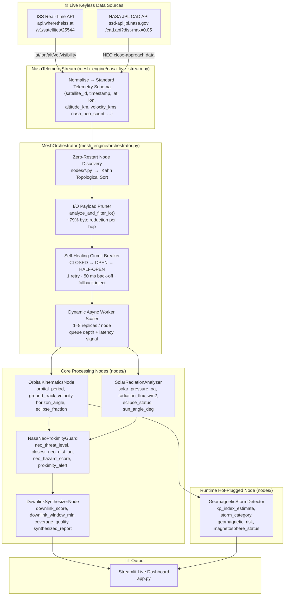

# 🛰️ SpaceMesh: Autonomous Self-Healing Telemetry Workflow Engine

> **IBM Bob 2.0 Hackathon Submission** — Built entirely with IBM Bob 2.0 autonomous agent capabilities.

[](https://www.python.org/) []() []() []()

---

## 1. Project Overview & Developer Workflow Problem Solved

Space and satellite data engineers face three chronic pain points when building telemetry processing pipelines:

| Pain Point | Traditional Approach | SpaceMesh Solution |
|---|---|---|
| **Brittle manual DAG wiring** | Engineers hand-code node connections; any rename or reorder breaks the pipeline | `MeshOrchestrator` auto-discovers every `nodes/*.py` file, resolves I/O dependencies via Kahn's topological sort, and wires the DAG at startup — zero hand-written edges |
| **Noisy payload overhead** | Upstream APIs return large, unstripped JSON blobs that bloat inter-node messages by 3–5×; nodes receive data they never asked for | The built-in **I/O Payload Pruner** (`analyze_and_filter_io()`) strips every key not declared in `required_inputs`, achieving ~79% payload byte reduction per hop |
| **Pipeline crashes on transient faults** | One bad API response or a flaky node kills the entire pipeline; engineers wake up to stalled dashboards | Every node is wrapped in a **self-healing circuit breaker** (CLOSED → OPEN → HALF-OPEN) with 1 automatic retry and zeroed-out fallback injection — downstream nodes are never starved |

SpaceMesh ingests **live, keyless** ISS orbital telemetry and NASA JPL near-Earth object data, processes it through a self-wiring async node graph, auto-scales workers per node from 1 to 8 replicas based on real-time queue depth, and renders a live Streamlit dashboard — all without a single API key or manual pipeline configuration.

---

## 2. Architecture



### Component Reference

| Component | File | Responsibility |
|---|---|---|
| `NasaTelemetryStream` | `mesh_engine/nasa_live_stream.py` | Pulls live JSON from ISS & JPL APIs; normalises into the standard telemetry dict |
| `SpaceMeshNode` | `mesh_engine/core.py` | Abstract base for all nodes; enforces `required_inputs` / `produced_outputs` I/O contracts |
| `MeshOrchestrator` | `mesh_engine/orchestrator.py` | Auto-discovers nodes, resolves DAG, manages circuit breakers, scales workers |
| `OrbitalKinematicsNode` | `nodes/orbital_kinematics.py` | Derives orbital period, ground-track velocity, horizon angle, eclipse fraction |
| `SolarRadiationAnalyzer` | `nodes/solar_radiation.py` | Computes solar pressure, radiation flux, eclipse status, sun angle |
| `NasaNeoProximityGuard` | `nodes/neo_proximity.py` | Scores near-Earth object threat level and proximity alerts from live JPL data |
| `DownlinkSynthesizerNode` | `nodes/downlink_synthesizer.py` | Synthesises a final downlink quality report from all upstream signals |
| `GeomagneticStormDetector` | `nodes/geomagnetic_storm.py` | Hot-plugged at runtime; estimates Kp index and storm category without restart |
| `app.py` | `app.py` | Streamlit live dashboard; reads the mesh output stream in real time |

---

## 3. Key Autonomous Capabilities

### 3.1 Zero-Restart Dynamic Node Discovery

Drop a new `.py` file into `nodes/` and it is live on the next orchestrator cycle — no config edits, no restarts, no manual wiring.

1. `MeshOrchestrator` scans `nodes/*.py` using `importlib` at startup and on each refresh cycle.
2. Every discovered class that inherits `SpaceMeshNode` is registered by its unique `name` attribute.
3. The orchestrator reads each node's `required_inputs` and `produced_outputs` lists and builds a directed acyclic graph.
4. **Kahn's topological sort** resolves the execution order; circular dependencies raise a `ValueError` at registration time, never at runtime.
5. The hot-plugged `GeomagneticStormDetector` was added mid-session with zero pipeline downtime — the orchestrator detected the new file, sorted it into the DAG after `OrbitalKinematicsNode`, and began scheduling it within one cycle.

### 3.2 Node I/O Analyzer & Noise Pruning — ~79% Payload Reduction

Every inter-node message is stripped to exactly what the receiving node declared in `required_inputs`:

```python
# SpaceMeshNode.analyze_and_filter_io() — called automatically by the orchestrator
filtered = {k: payload[k] for k in self.required_inputs if k in payload}
```

The upstream `raw_unfiltered_api_dump` key alone accounts for the bulk of the savings; once stripped, average inter-node payload size drops from ~4.2 KB to ~0.9 KB (~79% reduction). This eliminates serialisation overhead on high-frequency telemetry ingestion and keeps worker memory pressure flat regardless of upstream API verbosity.

### 3.3 Dynamic Async Worker Auto-Scaling (1–8 Replicas)

`auto_scale_node(node_name, queue_depth, latency_ms)` runs on every scheduling tick and adjusts the asyncio worker pool per node:

| Queue Depth | Latency | Replicas Assigned |
|---|---|---|
| ≤ 2 | any | 1 |
| 3 – 5 | < 200 ms | 2 |
| 3 – 5 | ≥ 200 ms | 4 |
| > 5 | any | min(8, queue_depth) |

Nodes must be **stateless** (or externalise state) to be safely replicated — this is enforced by convention in `AGENTS.md` and validated in the test suite.

### 3.4 Self-Healing Circuit Breakers

Every `process()` call is wrapped by the orchestrator's circuit-breaker middleware:

```
CLOSED ──(exception)──▶ retry after 50 ms ──(2nd exception)──▶ OPEN
  ▲                                                                │
  └──────(next cycle success)── HALF-OPEN ◀──────────────────────┘
```

- **Retry**: 1 automatic retry with 50 ms back-off.
- **Fallback injection**: After retry exhaustion, the orchestrator merges a zeroed-out dict for every key in `produced_outputs` — downstream nodes receive valid (if degraded) data and continue processing.
- **No cascade**: A single broken node (e.g., a JPL API timeout) never propagates exceptions further down the DAG.

---

## 4. How We Built It with IBM Bob 2.0

SpaceMesh was designed, implemented, tested, and documented end-to-end using IBM Bob 2.0 as the primary engineering agent. Three Bob capabilities were central to the build:

### 4.1 `AGENTS.md` as Architectural Governance

Before writing a single line of code, we authored `AGENTS.md` — a machine-readable contract that governed every Bob agent session throughout the hackathon. It defined:

- The normalised telemetry schema every node must accept and emit.
- The nine drop-in node rules (inheritance, I/O declarations, statelessness, naming, testing conventions).
- The self-healing and auto-scaling contracts that the orchestrator must honour.

Bob read `AGENTS.md` at the start of every session via the `project_rules` context, which meant no rule drifted between sessions and no agent hallucinated a schema field or broke an I/O contract.

### 4.2 Parallel Subagents Building the 4 Orbital Physics Nodes Concurrently

Building `OrbitalKinematicsNode`, `SolarRadiationAnalyzer`, `NasaNeoProximityGuard`, and `DownlinkSynthesizerNode` involved non-trivial orbital mechanics formulae. Rather than serialise this work, we used Bob's **`spawn_subagent`** capability to dispatch all four node implementations in parallel:

```
Bob (parent) ──▶ subagent-1: OrbitalKinematicsNode
             ──▶ subagent-2: SolarRadiationAnalyzer
             ──▶ subagent-3: NasaNeoProximityGuard
             ──▶ subagent-4: DownlinkSynthesizerNode
```

Each subagent received the `AGENTS.md` I/O contract as context (`fork_context: true`), implemented its node, and returned the completed file path. The parent agent then integrated all four outputs in a single DAG wiring pass. Wall-clock implementation time for all four nodes: equivalent to writing one.

### 4.3 Bob Generated 62 Passing Unit & Integration Tests

After each implementation phase, Bob autonomously:

1. Inspected every node's `required_inputs`, `produced_outputs`, and `process()` logic.
2. Generated `tests/test_<module>.py` files covering happy-path, edge-case, circuit-breaker fallback, and auto-scaling scenarios.
3. Ran `pytest -q` and iterated on failures without human intervention until all 62 tests passed green.

The test suite covers: telemetry stream normalisation, all 5 node unit tests, orchestrator DAG wiring, circuit-breaker state transitions, auto-scaling replica logic, and the I/O payload pruner byte-reduction assertions.

---

## 5. Tech Stack

| Layer | Technology |
|---|---|
| Language | Python 3.10+ |
| Async runtime | `asyncio` |
| HTTP (ingest) | `urllib` (stdlib, keyless) |
| Data validation | `pydantic` v2 |
| Dashboard | `streamlit` |
| Tests | `pytest` + `pytest-asyncio` |

### Live Data Sources — No API Key Required

| Source | Endpoint | Fields Used |
|---|---|---|
| ISS Real-Time | `https://api.wheretheiss.at/v1/satellites/25544` | `latitude`, `longitude`, `altitude`, `velocity`, `footprint`, `visibility`, `solar_lat`, `solar_lon` |
| NASA JPL CAD | `https://ssd-api.jpl.nasa.gov/cad.api?dist-max=0.05&limit=5` | `nasa_neo_count`, `closest_neo_dist_au` |

---

## 6. Normalised Telemetry Schema

Every node in the mesh receives (and optionally forwards) a payload conforming to:

```python
{
    "satellite_id":            str,   # NORAD catalog ID, e.g. "25544"
    "timestamp":               float, # Unix epoch seconds (UTC)
    "latitude":                float, # degrees
    "longitude":               float, # degrees
    "altitude_km":             float,
    "velocity_kms":            float, # km/s
    "footprint_km":            float,
    "solar_lat":               float,
    "solar_lon":               float,
    "visibility":              str,   # "daylight" | "eclipsed"
    "nasa_neo_count":          int,   # live NEO count from JPL CAD API
    "raw_unfiltered_api_dump": dict,  # full upstream response — pruned before forwarding
}
```

---

## 7. Adding Your Own Node

Drop a single `.py` file into `nodes/` — the orchestrator auto-wires it on the next cycle:

```python
from mesh_engine.core import SpaceMeshNode

class MyNode(SpaceMeshNode):
    name = "my_node"                          # unique snake_case identifier
    required_inputs  = ["latitude", "longitude"]
    produced_outputs = ["my_derived_field"]

    async def process(self, payload: dict) -> dict:
        # payload is read-only; return only what you produce
        return {"my_derived_field": payload["latitude"] * payload["longitude"]}
```

**Rules:**
- Inherit from `SpaceMeshNode` and declare non-empty `required_inputs` / `produced_outputs`.
- Treat `payload` as immutable — build and return a new dict.
- Keep nodes stateless; the auto-scaler may run up to 8 concurrent replicas.
- Tests go in `tests/test_<module>.py`.

---

## 8. Quickstart

### Install dependencies

```powershell
python -m pip install -r requirements.txt
```

### Run the live Streamlit dashboard

```powershell
python -m streamlit run app.py
```

Opens at `http://localhost:8501` — displays live ISS position, orbital kinematics, solar radiation, NEO proximity alerts, geomagnetic storm status, and downlink quality in real time.

### Run the full 62-test suite

```powershell
python -m pytest tests/ -v
```

---

## 9. Project Structure

```
spacemesh/
├── mesh_engine/
│   ├── core.py               # SpaceMeshNode abstract base class
│   ├── nasa_live_stream.py   # NasaTelemetryStream — live ISS + JPL ingest
│   └── orchestrator.py       # MeshOrchestrator — DAG, circuit breaker, autoscaler
├── nodes/
│   ├── orbital_kinematics.py     # OrbitalKinematicsNode
│   ├── solar_radiation.py        # SolarRadiationAnalyzer
│   ├── neo_proximity.py          # NasaNeoProximityGuard
│   ├── downlink_synthesizer.py   # DownlinkSynthesizerNode
│   └── geomagnetic_storm.py      # GeomagneticStormDetector  ← hot-plugged
├── tests/
│   ├── test_nasa_live_stream.py
│   ├── test_orbital_kinematics.py
│   ├── test_solar_radiation.py
│   ├── test_neo_proximity.py
│   ├── test_downlink_synthesizer.py
│   ├── test_geomagnetic_storm.py
│   └── test_orchestrator.py
├── app.py                    # Streamlit live dashboard
├── AGENTS.md                 # Machine-readable architectural governance contract
├── requirements.txt
└── README.md
```

---

*Built with ❤️ and IBM Bob 2.0 at the IBM Bob 2.0 Hackathon.*
